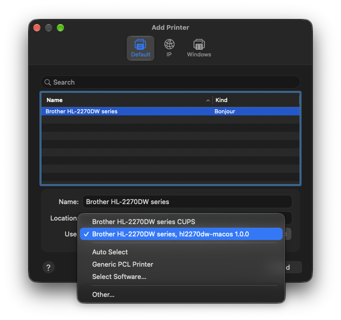
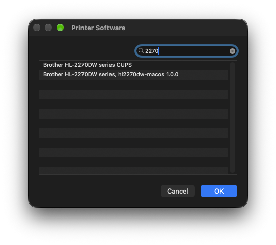
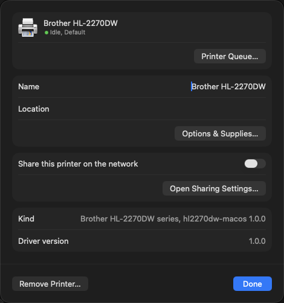

# hl2270dw-macos

A native macOS driver for the **Brother HL-2270DW** monochrome laser printer.

Brother's last Mac driver for this printer (2019) is Intel-only and runs on
Apple silicon only through Rosetta. This driver is a universal binary
(Apple silicon and Intel, macOS 11 or later) and supports the same printer
features, including toner and drum levels.

It is based on [brlaser](https://github.com/Owl-Maintain/brlaser), the
open-source CUPS driver for Brother lasers, and adds what the HL-2270DW
needs to behave like it does with Brother's own driver.

> **Supported printer:** the Brother HL-2270DW only. For other Brother
> monochrome lasers, see [brlaser](https://github.com/Owl-Maintain/brlaser),
> which supports many more models.

> **Status:** 1.0.0. Tested on an HL-2270DW over the network, including
> two-sided printing, manual feed, HQ 1200, toner save and supply levels.
> Output has also been compared with Brother's driver page by page (see
> [Testing](#testing)).

## Features

| Setting | Values |
| --- | --- |
| Paper size | Letter, A4, Legal, Executive, A5, A5 Long Edge, A6, B5, JIS B5, B6, Folio, Com-10, DL, DL Long Edge, C5, Monarch, 3 x 5, Hagaki, Envelope #4, Envelope MAX, and custom sizes from 3 x 4.57 in to 8.5 x 16 in |
| Two-sided printing | Off, long-edge, short-edge (Letter, A4, Legal, Folio) |
| Resolution | 300 dpi, 600 dpi, HQ 1200 |
| Media type | Plain, thin, thick, thicker, bond, envelopes (normal, thick, thin), recycled, label, postcard |
| Paper source | Auto select, tray 1, manual feed slot; macOS "First page from" is supported |
| Toner Save Mode | Off, on |
| Density Adjustment | Printer default, or -6 (lighter) to +6 (darker) |
| Improvement Settings | Off, reduce paper curl, improve toner fixing |
| Reduce Ghosting | Off, on |
| Skip Blank Page | Off, on |
| Sleep Time | Printer default, or 1 to 210 minutes |
| Supply levels | Toner and drum, shown in Printers & Scanners |
| Printer status | Paper out, jams, open cover, low or empty toner |
| Maintenance | Printer self-test page |

The option names and values are the same as in Brother's driver, so
settings saved with `lpoptions` carry over.

### Compared with brlaser

brlaser supports the HL-2270DW too, with a profile shared by many Brother
models. Packages that build brlaser for Apple silicon use that same
profile. For this printer, this driver adds:

| | brlaser 6.2.8 | This driver |
| --- | --- | --- |
| Page placement | About 1.4 mm higher and 0.5 mm further right than Brother's driver | Same as Brother's driver |
| Paper sizes | 11, no custom sizes | 20, plus custom sizes |
| JIS B5 | Printed as ISO B5, so the bottom of the page is cut off ([fix submitted](https://github.com/Owl-Maintain/brlaser/pull/91)) | Correct |
| Paper source | Lists Tray 2, Tray 3 and MP Tray, which this printer doesn't have | Auto select, tray 1, manual feed slot |
| Media types | No recycled, label or postcard | Brother's list |
| Brother options | Toner save, toner density | Toner save, density adjustment, improvement settings, reduce ghosting, skip blank page, sleep time |
| Supply levels and printer status | Not available | Toner, drum, paper out, jams, open cover |
| Self-test page | No | Yes |
| Macs | Depends on the package | Apple silicon and Intel, macOS 11 or later |

For any other Brother printer, use brlaser.

## Installing

1. Download `hl2270dw-macos-<version>.pkg` from
   [Releases](https://github.com/jmarler/hl2270dw-macos/releases) and open
   it. The package is signed and notarized by Apple.
2. Open **System Settings > Printers & Scanners**, click **Add Printer,
   Scanner, or Fax…**, and click the HL-2270DW in the list. The list shows
   printers, not drivers, so this driver doesn't appear there. To switch a
   printer you already have to this driver, remove it and add it again.
3. Open the **Use** menu at the bottom of the window, choose
   **Brother HL-2270DW series, hl2270dw-macos** (followed by the version
   number), and click **Add**. The menu is dimmed until you click a
   printer in the list.

   

   If Brother's driver is also installed, macOS usually picks it
   (**Brother HL-2270DW series CUPS**), so check the **Use** menu before
   clicking **Add**. You don't need to uninstall Brother's driver.

   If this driver isn't in the menu, choose **Select Software…**, type
   `2270` in the search field, and pick it from the list:

   

### Checking which driver a printer uses

Click the printer in **Printers & Scanners**. **Kind** and **Driver
version** show which driver it uses:



| | This driver | Brother's driver |
| --- | --- | --- |
| Kind | Brother HL-2270DW series, hl2270dw-macos | Brother HL-2270DW series CUPS |
| Driver version | 1.0.0 or later | Brother's version, such as 4.5.1 |

In Terminal, `grep -H '^\*NickName' /etc/cups/ppd/*.ppd` lists the driver
for every printer.

To set up a second queue for testing, next to an existing one:

```sh
macos/add-queue.sh            # uses the address of your current HL-2270DW queue
```

Supply levels and printer status need a network connection (they are read
over SNMP). Printing over USB works, but levels are not shown.

### Uninstalling

```sh
sudo /Library/Printers/hl2270dw/uninstall.sh
```

## Building from source

You need Xcode (or the Command Line Tools) and CMake.

```sh
cmake -S . -B build -DCMAKE_BUILD_TYPE=Release
cmake --build build
(cd build && ctest)
```

This builds universal binaries, the PPD (`build/ppd/hl2270dw.ppd`), and the
tests. To build the installer package:

```sh
macos/build-pkg.sh
```

The script signs with the first Developer ID identities in your keychain.
Set `APP_IDENTITY=-` and `INSTALLER_IDENTITY=-` to build without
certificates, and `NOTARY_PROFILE=<profile>` to notarize.

## Testing

* `ctest` runs the unit tests (brlaser's and this driver's).
* `test/compare_brother.py build` runs 49 cases through both this driver
  and Brother's (if installed), decodes both print streams, and compares the
  printer commands and every page bit for bit. Cases cover all paper sizes,
  custom sizes, resolutions, duplex, trays, media types, and the Brother
  options.
* `test/tools/run_with_backend.py` runs a filter connected to a real CUPS
  backend, as `cupsd` would, without installing anything. It is how supply
  levels are tested against a printer.
* `test/tools/prndecode.py` decodes a print stream into its commands and
  page images.

## How it works

macOS renders each page to a 1-bit black and white raster. The filter
`rastertohl2270dw` turns that into the printer's language:

1. A PJL header with the job settings (resolution, toner save, media type,
   paper size, and the Brother options).
2. PCL with Brother's "mode 1030" raster compression, in which each line is
   encoded as changes to the line before it.

The printable area macOS provides starts 1/4 inch from the paper edge; the
filter shifts each line to where the printer expects it. Custom paper sizes
are sent as the smallest standard size they fit in, centered, because the
printer feeds paper center-aligned.

`commandtohl2270dw` handles the commands macOS sends from Printers &
Scanners: **ReportLevels** reads Brother's maintenance data over SNMP
(toner and drum remaining) and **PrintSelfTestPage** prints the printer's
test page.

### Differences from Brother's driver

* Halftoning is done by macOS, so Brother's "Graphics Quality" setting
  (graphics or text halftone) does not exist.
* Toner and drum levels are reported as percentages; Brother's Mac driver
  shows coarse levels.
* Quotes in job titles are replaced instead of being copied into the
  printer commands, which broke them.
* Postcard paper always uses the thick paper path.
* **Density Adjustment** is not in Brother's HL-2270DW driver, but the
  printer honors it. It works like the setting in Brother's drivers for
  other models.
* When a later page changes paper size, resolution, or duplex, the printer
  receives updated settings for that page.

## Credits and license

Based on brlaser by Peter De Wachter and the
[Owl-Maintain](https://github.com/Owl-Maintain/brlaser) maintainers
(see [README.brlaser.md](README.brlaser.md)). Distributed under the
GNU General Public License, version 2 or later; see [COPYING](COPYING).

Brother and HL-2270DW are trademarks of Brother Industries, Ltd. This
project is not affiliated with or endorsed by Brother.
